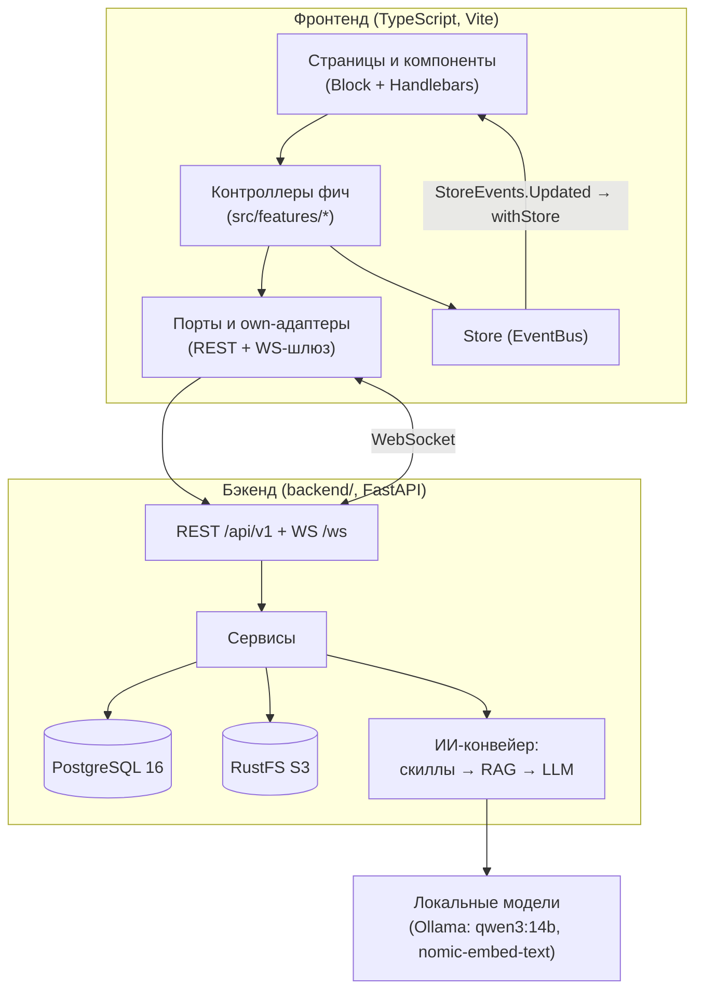

[](http://commitizen.github.io/cz-cli/)
[](https://app.netlify.com/sites/startling-faloodeh-01b44f/deploys)
<h1 align="center">Chatty — self-hosted мессенджер с ИИ-ассистентом</h1>

## О проекте

**Chatty** — веб-мессенджер для внутренней сети компании со встроенным
ИИ-ассистентом. Проект начинался как учебный мессенджер курса middle.messenger
и вырос в полноценный продукт: собственный бэкенд, RAG-поиск по документам,
отпускной HR-скилл с генерацией заявлений и стриминг ответов модели.

Ключевые свойства:

- **Self-hosted и on-premise.** Весь контур — свой: фронтенд, FastAPI-бэкенд,
  PostgreSQL, S3-хранилище RustFS и локальные LLM (Ollama: `qwen3:14b` +
  `nomic-embed-text`). Персональные данные и документы не покидают контур
  компании — публичные нейросети не используются.
- **Фронт без фреймворков.** Чистый TypeScript, собственный компонентный слой
  на классе `Block` (жизненный цикл на `EventBus`, Proxy над пропсами,
  keyed-переиспользование инстансов), шаблоны Handlebars, сборка Vite.
- **Однонаправленный поток данных.** Компонент → контроллер → API/WS-шлюз →
  бэкенд; ответ пишется в `Store`, событие Store перерисовывает страницу через
  `withStore`. Архитектурные границы слоёв контролирует автоматический
  guard-хук.

## Возможности

### Мессенджер

- Авторизация и регистрация, cookie-сессии (JWT access/refresh + CSRF
  double-submit), профиль с аватаром, настройки: тема light/dark/system,
  приватность (отчёты о прочтении), звуковые и браузерные уведомления,
  лимиты автозагрузки вложений
- Чаты: one-click создание с серверным авто-названием «Чат с …»,
  диалоги 1:1 (`POST /chats/dm`), переименование с рассылкой участникам,
  архив/выход с разной семантикой (выход сохраняет историю, кик — нет),
  «+AI» в любом чате, «Пометить всё прочитанными»
- Сообщения в реальном времени (WebSocket): реакции, ответы, вложения,
  служебные строки-события, серии сообщений со склейкой пузырей,
  курсорная пагинация истории «загрузить ещё» (`before_id`, дедупликация)
- Живой поиск по чатам и сообщениям (pg_trgm-индексы, подсветка совпадений)
  и `'@'`-поиск соучастников чата
- Stories с 24-часовым TTL и живым фан-аутом (`story_created` /
  `story_deleted` по WS)
- Контакты как адресная книга: добавление через поиск, создание диалога в
  один клик, «Найти все чаты с человеком»
- Устойчивость связи: bounded-реконнект WebSocket с растущим backoff,
  offline/online-оверлей, force-переподключение застрявших сокетов

### ИИ-ассистент

- AI-чат с ботом-участником: ответ стримится по мере генерации
  (SSE → `bot_delta` по WS), с анимацией «печатает»
- **RAG-поиск по документам**: загрузка PDF/DOCX → конвертация и чанкинг →
  эмбеддинги → поиск по косинусной близости; в ответе — список
  документов-источников, нерелевантные чанки отсекаются порогом
- **Отпускной скилл**: ответы на вопросы «когда мой отпуск» по
  корпоративному графику (ингест `график отпусков *.xlsx` в БД)
- **Генерация заявлений**: «оформи заявление на отпуск / перенос /
  за свой счёт» → диалоговый визард → готовый RTF-файл вложением в чат
  (шаблоны с плейсхолдерами, реквизиты из настроек окружения)
- LLM-автоназвание чата по содержанию диалога
- Отказоустойчивость: durable-раны (`bot_runs` в PostgreSQL, CAS-клейм,
  идемпотентные ретраи, reclaim зависших), kill-switch стриминга и
  thinking, честные ошибки на фронте

### Платформа

- Собственный бэкенд: FastAPI + SQLAlchemy 2 + Alembic (16 миграций),
  PostgreSQL 16, объектное хранилище RustFS (S3-совместимое), compose-стек с
  health/ready-проверками и seed
- Тесты: 830+ mocha (фронт) и 449+ pytest (бэкенд); единые гейты
  `npm run verify` / `verify:backend` / `verify:all`
- CI на каждый PR, conventional commits, архитектурный guard в хуке

## Архитектура



Подробная документация с диаграммами — в [docs/arch/](docs/arch/README.md):
[компонентный слой](docs/arch/component-system.md),
[роутинг и состояние](docs/arch/routing-and-state.md),
[слой данных](docs/arch/data-layer.md),
[бэкенд](docs/arch/backend.md),
[ИИ-ассистент](docs/arch/ai-assistant.md),
[сборка и инфраструктура](docs/arch/build-and-infra.md).

## Установка и запуск

1. Клонируйте репозиторий: `git clone https://github.com/BJuice1984/chatty.git`
2. `npm ci` (Node `^20.19.0 || >=22.12.0`)
3. Адреса бэкенда: `.env.development` уже указывает на локальный compose-стек;
   для другого стенда скопируйте `.env.example` → `.env` (или
   `.env.own.example` → `.env.own`) и поправьте URL
4. Команды:
   - `npm run dev` — dev-сервер на порту 3001 против локального бэкенда
   - `npx vite --mode own` — то же с явным Vite-режимом `own` (грузит `.env.own`)
   - `npm run build` — проверка типов + сборка в `dist/`
   - `npm start` — сборка и express-статика из `dist/` на порту 3001

Собственный бэкенд поднимается compose-стеком (api + PostgreSQL + RustFS;
Ollama — внешняя зависимость хоста). Preflight, health/ready-проверки и
откат — в runbook [docs/deployment/own-backend.md](docs/deployment/own-backend.md);
коротко:

```bash
docker compose --env-file <операторский-env> config --quiet   # preflight
docker compose --env-file <операторский-env> up -d --build    # api + db + rustfs
curl -f http://127.0.0.1:8000/health && curl -f http://127.0.0.1:8000/ready
```

## Проверки

```bash
npm run verify         # typecheck + mocha + eslint + stylelint (fail-fast)
npm run verify:backend # backend/verify.sh: pytest + alembic (свой бэкенд)
npm run verify:all     # фронт + бэкенд
npm test               # только mocha; один файл: npm test -- src/core/Block.test.ts
```

Pre-commit хук (husky) прогоняет `npm run verify`; коммиты — conventional
(`npm run cm`).

## Используемый стек


## Документация

- [docs/arch/](docs/arch/README.md) — архитектура фронтенда и бэкенда
- [docs/deployment/own-backend.md](docs/deployment/own-backend.md) — runbook
  собственного бэкенда (compose, health/ready, rollback)
- [docs/deployment/vacation-schedule.md](docs/deployment/vacation-schedule.md) —
  ингест и обновление графика отпусков
- [docs/deployment/vacation-forms.md](docs/deployment/vacation-forms.md) —
  шаблоны заявлений и реквизиты
- [docs/progress/progress_log.md](docs/progress/progress_log.md) — история
  изменений

## [Ссылка на проект](https://deploy-preview-5--startling-faloodeh-01b44f.netlify.app/)
## [Ссылка на макет Figma](https://www.figma.com/file/bM8yGd4zQLl4H7VQSThAma/Chatty-UI-Kit---Messenger-App?type=design&node-id=0%3A1&mode=design&t=S96tosRx5QfhpWsh-1)

## Автор

[Ильяс Сибгатуллин](https://github.com/BJuice1984): [i.sibgatullin59@gmail.com](i.sibgatullin59@gmail.com)
