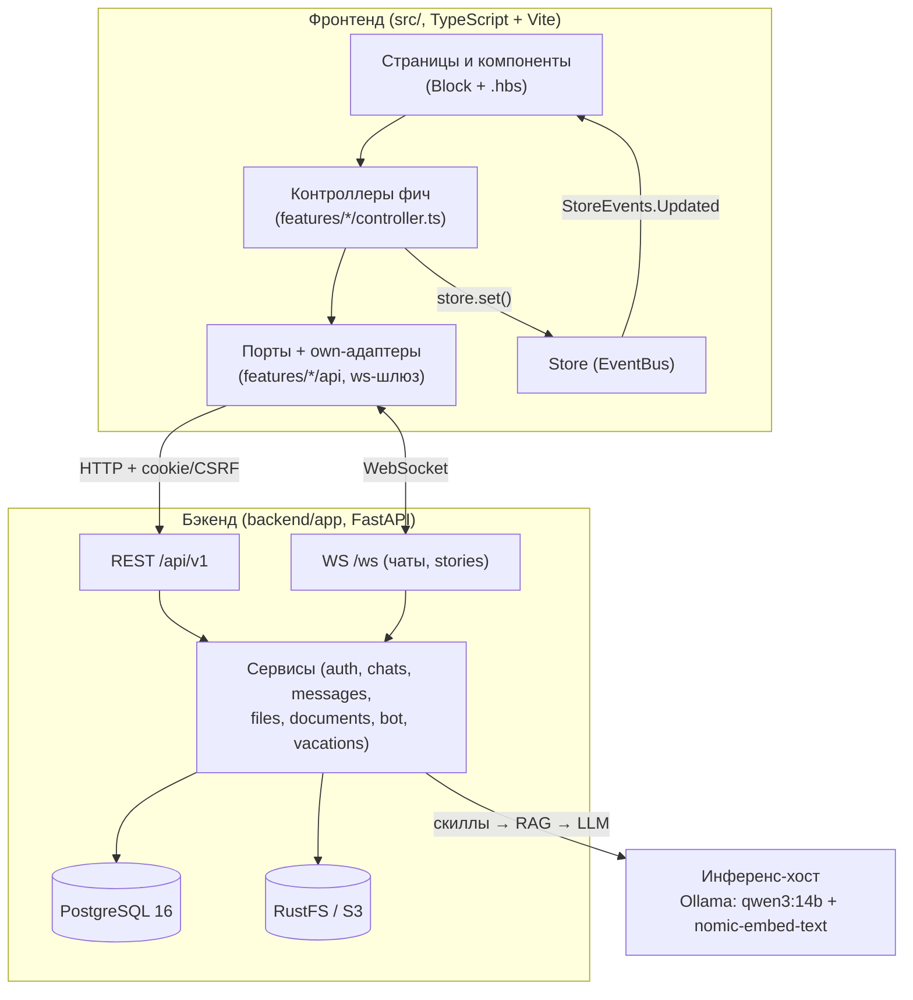

# Архитектура Chatty

Документы в этой папке описывают архитектуру **Chatty** — self-hosted
веб-мессенджера со встроенным ИИ-ассистентом. Проект начинался как учебный
мессенджер курса middle.messenger и вырос в полноценное приложение: SPA на
чистом TypeScript без фреймворков (собственный компонентный слой на
Handlebars-шаблонах) + собственный бэкенд `backend/` (FastAPI, PostgreSQL,
RustFS, локальные LLM через Ollama).

## Разделы

| Документ | О чём |
|---|---|
| [component-system.md](component-system.md) | Компонентный слой: `Block`, `EventBus`, `registerComponent` (keyed-кэш), `.hbs`-шаблоны, жизненный цикл |
| [routing-and-state.md](routing-and-state.md) | Роутинг (`Router`), auth-гарды и глобальное состояние (`Store`, `withStore`, `reset`) |
| [data-layer.md](data-layer.md) | Контроллеры и фичи, порты и адаптеры, `HTTPTransport` (XHR), `WSTransport` (WebSocket, bounded-реконнект) |
| [backend.md](backend.md) | Собственный бэкенд: слои FastAPI, домены, модель данных, WS-хабы, файлы, миграции |
| [ai-assistant.md](ai-assistant.md) | ИИ-контур: durable-раны бота, RAG-поиск, промпты, отпускные скиллы (даты + RTF-заявления) |
| [build-and-infra.md](build-and-infra.md) | Сборка Vite + кастомный плагин, тесты, CI, compose-стек, Netlify, ALK |
| [known-issues.md](known-issues.md) | Известные особенности и техдолг — бэклог для исправления |

## Общая картина

Два деплояемых контура. **Фронтенд** — SPA без фреймворков, разделён на слои
с зависимостями только вниз:
`pages → components → controllers → api-адаптеры → utils → core/helpers`.
UI не ходит в сеть сам — только через контроллеры фич. **Бэкенд** —
FastAPI-приложение с послойной архитектурой
`endpoints → services → repositories → models` и WebSocket-хабами.
Состояние возвращается наверх событийно: контроллер пишет ответ бэкенда в
`Store`, событие Store через `withStore` обновляет пропсы страниц.



Ключевые принципы:

- **Компоненты не ходят в сеть.** За данные отвечают контроллеры фич;
  компонент вызывает метод контроллера и перерисовывается, когда контроллер
  обновит Store.
- **Единый источник правды о состоянии** — `Store`; подписка через HOC
  `withStore(mapStateToProps)` со сравнением среза (`shallowEqual`) —
  подписчик перерисовывается только при изменении своих данных.
- **Никакого виртуального DOM.** `Block.setProps()` батчится (один
  `FLOW_CDU` на вызов) и перерисовывает блок целиком (`replaceWith`);
  горячие компоненты (сообщения ленты) переиспользуются по `cacheKey`.
- **Шаблоны — Handlebars**, предкомпилируются в JS-модули на этапе сборки
  кастомным vite-плагином; вложенные компоненты вставляются в шаблон как
  Handlebars-хелперы.
- **Фичи-модули за портами.** `src/features/*` самодостаточны; между фичами
  только порты и композиция (`features/index.ts`, `core/module`). Границы
  следит автоматический guard-хук (см. [build-and-infra.md](build-and-infra.md)).

## Раскладка по каталогам

```
├── src/                     # фронтенд
│   ├── main.ts              # вход: регистрация компонентов, маршруты, bootstrap
│   ├── core/                # фундамент: Block, EventBus, registerComponent, module
│   ├── features/            # фичи-модули: auth, chats (ws/stories/history),
│   │                        #   profile, contacts, ai-assistant
│   ├── pages/               # статические страницы: 404, 500
│   ├── components/          # переиспользуемые компоненты (.ts + .hbs рядом)
│   ├── utils/               # Router, Store, HTTPTransport, WSTransport, theme
│   ├── helpers/             # isEqual, set/merge
│   └── scss/                # стили: components/, utils/, libs/
├── backend/                 # собственный бэкенд (FastAPI)
│   ├── app/
│   │   ├── api/v1/endpoints/# REST-домены: auth, users, chats, bot, files, …
│   │   ├── services/        # бизнес-логика
│   │   ├── repositories/    # запросы к БД
│   │   ├── models/          # ORM-модели SQLAlchemy
│   │   ├── ws/              # WebSocket: хабы чатов и stories
│   │   ├── bot/             # провайдер LLM + промпты
│   │   ├── ingestion/       # RAG: парсеры, чанкинг, эмбеддинги
│   │   └── vacations/       # отпускной скилл + RTF-формы заявлений
│   ├── alembic/versions/    # миграции БД (001–016)
│   └── tests/               # pytest
├── docs/                    # документация (arch/, deployment/, progress/)
├── server/server.js         # express-статика для локальной проверки prod
└── docker-compose.yml       # стек: api + PostgreSQL + RustFS
```

## Известные особенности

Известные шероховатости и кандидаты на исправление собраны в отдельный
бэклог: **[known-issues.md](known-issues.md)**.
