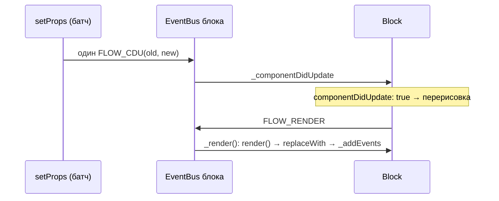

# Компонентный слой

Основа UI — собственный класс `Block` (`src/core/Block.ts`): жизненный цикл
в духе React, но без виртуального DOM и реconciliation — изменение пропсов
перерисовывает блок целиком. Горячие списки (лента сообщений) экономятся
keyed-кэшем инстансов (см. ниже).

## Участники

### `Block` — `src/core/Block.ts`

Базовый класс всех компонентов и страниц. Обязательный контракт наследника —
переопределить `render()`:

```ts
export class Button extends Block {
    constructor(props: ButtonProps) {
        super({ ...props, events: { click: props.onClick } })
    }

    render() {
        return this.compile(template, this.props) // template — импорт из .hbs
    }
}
```

Ключевые механики:

- **Разделение props/children.** В конструкторе значения-инстансы `Block`
  из переданного объекта выносятся в `this.children`, остальное — в
  `this.props`. Дети передаются в шаблон как обычные пропсы.
- **Proxy над пропсами.** `this.props` обёрнут в Proxy: прямая запись
  (`this.props.x = …`) эмитит `FLOW_CDU` пер-ключево; удаление свойств
  запрещено (бросает ошибку).
- **Батчинг `setProps`.** `setProps(nextProps)` пишет в raw-объект МИМО
  сет-ловушки и эмитит **один** `FLOW_CDU` на вызов со снапшотами до/после —
  N ключей в одном обновлении больше не дают N перерисовок.
- **Жизненный цикл на EventBus.** Каждый блок владеет собственным
  `EventBus`; события (`Block.EVENTS`): `init → flow:render →
  flow:component-did-mount` / `flow:component-did-update`. Хуки:
  `init()`, `componentDidMount()`, `componentDidUpdate(old, new)`.
  CDM срабатывает ровно один раз за жизнь инстанса (флаг на инстансе).
- **Перерисовка.** `_render()` берёт `DocumentFragment` из `render()`,
  заменяет элемент через `replaceWith` и перевешивает DOM-события. События
  задаются пропсом `events: { click: fn, … }` на корневой элемент блока.
- **`compile(template, context)`** — рендер Handlebars-шаблона с подмешанной
  картой `__refs`; после прогона исполняет `embed`-функции детей (замена
  заглушек на живые DOM-узлы).
- **`destroy()`** — идемпотентный разбор: рекурсивно уничтожает
  `this.children` и hbs-встроенных детей (кроме cache-retained, см. ниже),
  снимает DOM-события и lifecycle-обработчики, удаляет элемент. Без
  `destroy()` подписки `withStore`-обёрток текли бы при уходе с маршрута.

### `EventBus` — `src/core/EventBus.ts`

Типизированный pub/sub (`on` / `off` / `emit`). Используется в четырёх
ролях: шина жизненного цикла блока, основа `Store`, основа `WSTransport`,
шина WS-событий шлюза.

### `registerComponent` — `src/core/registerComponent.ts`

Регистрирует класс компонента как **Handlebars-хелпер**, что позволяет
вкладывать компоненты друг в друга прямо в шаблоне:

```hbs
{{#Input ref="login" name="login" label="Логин" /}}
```

Механика:

1. Хелпер создаёт инстанс `new Component(hash)` (hash = атрибуты шаблона).
2. Возвращает заглушку `<div data-id="<nanoid>">…</div>`.
3. Инстанс и `embed`-функция кладутся в `root.__children`; атрибут `ref`
   сохраняет блок в `root.__refs[ref]` (доступ из TS через `this.refs.<name>`).
4. `compile()` родителя заменяет заглушки на реальные DOM-узлы детей.

Двойная регистрация имени бросает ошибку.

### Keyed-кэш и retained-инстансы (экономика рендера ленты)

Опциональный атрибут `cacheKey` включает переиспользование инстансов между
рендерами родителя:

- **Попадание по ключу** (`id:<n>` для сообщений, `pending:tail` для
  плейсхолдера бота) — живому инстансу делается `setProps`, а `embed`
  переносит его СУЩЕСТВУЮЩИЙ DOM-узел в новый рендер: элементы ввода,
  фокус и эмодзи-пикер переживают перерисовку списка.
- **Retained-метка.** Кэшированный инстанс помечается WeakSet'ом
  (`markBlockRetained`): ни смета `compile()` (замена списка детей), ни
  `destroy()` родителя его не трогают — временем жизни владеет кэш.
- **`pruneComponentCache(alive)`** — единственный уборщик: уничтожает и
  удаляет записи, чьих ключей нет в переданном множестве (смена чата,
  удаление сообщения). Мессенджер зовёт prune с ключами текущей ленты —
  кэш не растёт неограниченно.

Без `cacheKey` поведение прежнее: новый инстанс на каждый вызов хелпера.

### `.hbs`-шаблоны

Лежат рядом с компонентом (`button.ts` + `button.hbs`). На этапе сборки
vite-плагин `vite-plugin-handelbars-precompile.ts` превращает `.hbs`-файл
в ES-модуль с предкомпилированным шаблоном — в рантайме компиляции нет.
Подробнее — в [build-and-infra.md](build-and-infra.md).

## Жизненный цикл блока



Монтирование: `dispatchComponentDidMount()` (роутер/родитель) эмитит
`FLOW_CDM` и рекурсивно то же для всех детей — `this.children` плюс
hbs-встроенные (`__children`), то же множество обходит и `destroy()`.

## Страницы и композиция

Страницы — те же `Block`, только крупнее: собирают композицию компонентов
из пропсов-массивов и описывают обработчики. Страницы фич живут в
`features/*/pages/*` (login, register, chat, profile, contacts, assistant),
статические — в `src/pages/*` (404, 500). Реестр хелперов — бочки
`src/components/components.ts`; их перебирает `src/main.ts` при старте.

## Ограничения и соглашения

- `componentDidUpdate` в базе всегда возвращает `true` — «не перерисовывать
  при равных пропсах» нет (селективность обеспечивается раньше: `withStore`
  сравнивает срез, `set` не эмитит пустые записи); см.
  [known-issues.md](known-issues.md).
- События навешиваются только на корневой элемент блока; для вложенных
  элементов — отдельные компоненты.
- Доступ к DOM ребёнка из родителя — через `ref` в шаблоне и
  `this.refs.<name>`, а не `querySelector`.
- Фокус/черновики полей, живущих в часто перерисовываемых списках, — либо
  keyed-кэш (`cacheKey`), либо модульные слоты состояния
  (`composer-state.ts`, `feed-scroll.ts` — узор «общий модуль-слот,
  CDU пишет, render читает»).
- Тесты компонентов кладутся рядом (`button.test.ts`) и в eslint не
  проверяются.
