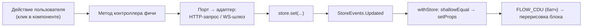

# Роутинг и состояние

## Router — `src/utils/Router.ts`

Singleton на History API (не hash-роутинг). Инстанс создаётся при импорте
модуля и монтирует страницы в `#app` (см. `index.html`):

```ts
export default new Router('#app')
```

Устройство:

- **`Route`** — связка «путь → класс страницы → селектор корня». Хранит
  созданный инстанс блока; `leave()` уничтожает его (`destroy()` — с ним
  подписки withStore), при возврате на маршрут страница создаётся заново.
- **`Router.use(pathname, BlockClass)`** — регистрация маршрута, возвращает
  `this` (чейнинг). Маршруты объявлены в `src/main.ts` (`Routes`), пути —
  константы в `src/utils/constants.ts`.
- **`start()`** — вешает `window.onpopstate` и рендерит текущий путь.
- **`go(path)`** — `history.pushState` + немедленный рендер;
  **`back()` / `forward()`** — обёртки над history.

Маршруты (вход — `/`, страница логина живёт на корне):

| Путь | Страница |
|---|---|
| `/` | логин |
| `/sign-up` | регистрация |
| `/messenger` | мессенджер (список чатов + лента + stories) |
| `/settings` | профиль и настройки (шесть секций) |
| `/contacts` | контакты |
| `/assistant` | AI-ассистент (RAG-поиск и вопрос-ответ) |
| `/404`, `/500` | статические страницы ошибок |

Особенности:

- Неизвестный путь: `getRoute` не находит маршрут, `_onRoute` тихо выходит —
  автоперехода на `/404` нет (см. [known-issues.md](known-issues.md)).
- **Защита маршрутов** — не в роутере. Auth-модуль (`features/auth/module.ts`)
  ставит allowlist-гард на защищённые роуты при сборке приложения
  (`createApp(featureModules)`); `src/main.ts` до старта роутера ждёт
  `fetchUser()`, чтобы гарды не видели пустой Store при холодной загрузке
  валидной сессии. Публичные пути (`/`, `/sign-up`) — только логин и регистрация.

## Store — `src/utils/Store.ts`

Глобальное состояние приложения, расширяет `EventBus`. Один инстанс на
модуль (`export default store`).

- **Форма состояния** — интерфейс `AppState`: `user`, `chats`, `chatsLoading`,
  `selectedChat`, `chatUsers`, `messages.<chatId>`, `stories`,
  `authError`, `authLoading`. Часть фичевых срезов (`stories`, `contacts`)
  типизирована внутри фич и читается приведением типа — ядро остаётся
  shape-agnostic.
- **`set(keypath, data)`** — записывает по пути (`'messages.123'`), снимок
  до/после сравнивается (JSON-строка), при отсутствии изменений эмит
  пропускается — пустые записи не будят подписчиков.
- **`reset()`** — полный сброс состояния с эмитом `Updated` (выход из
  аккаунта): каждый подписчик перерисуется с пустыми слайсами — лента
  предыдущего пользователя недостижима для следующего.
- **`getState()`** — снимок состояния.

Пишут в Store только контроллеры (`store.set('chats', …)`); компоненты
состояние не меняют.

## `withStore(mapStateToProps)` — HOC

Подписка компонента на состояние в декларативном стиле:

```ts
export class Messenger extends withStore(state => ({
    chats: state.chats,
    selectedChat: state.selectedChat,
}))(Block) { … }
```

Механика (`src/utils/Store.ts`):

1. В конструкторе обёртки `mapStateToProps` прогоняется над текущим
   состоянием, результат мержится в пропсы.
2. Подписка на `StoreEvents.Updated`: новый срез сравнивается с прошлым
   **поверхностно** (`shallowEqual`) — `setProps` вызывается только при
   изменении собственных данных компонента (селективность).
3. `destroy()` обёртки снимает подписку — ушедшие со маршрута страницы не
   получают обновлений.

## Полный цикл обновления



## Темы оформления

`src/utils/theme.ts` — light/dark/system, применяется установкой
`data-theme` на корневом элементе; выбор персистится в настройках
(`/settings` → Appearance) и применяется на старте `main.ts` (`initTheme()`),
до первого рендера — без вспышки неправильной темы.
